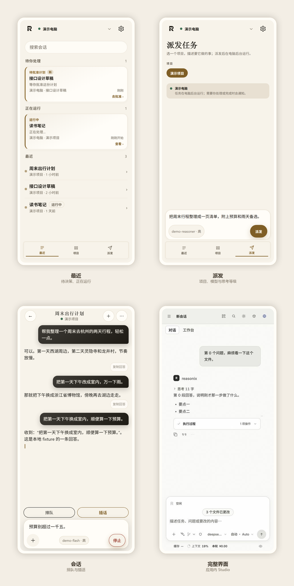
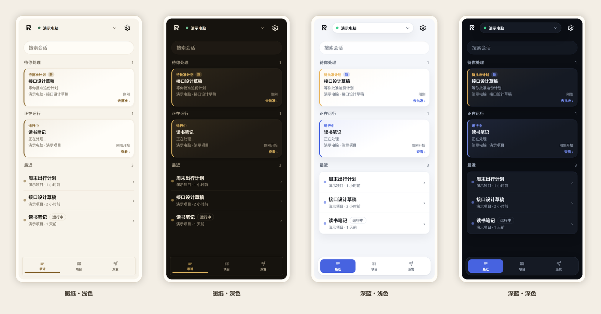

<h1 align="center">Reasonix For Android</h1>

<p align="center">
  <strong>Reasonix Studio in your pocket.</strong><br>
  The phone draws the screen and holds the connection; the model and the work stay on your desktop.
</p>

<p align="center">
  <a href="https://github.com/f1shsmell/Reasonix-Android/actions/workflows/ci.yml"></a>
  <a href="https://github.com/f1shsmell/Reasonix-Android/releases"></a>
  <a href="https://github.com/f1shsmell/Reasonix-Android/blob/main/LICENSE"></a>
  
</p>

<p align="center">
  <a href="https://github.com/f1shsmell/Reasonix-Android/releases/latest"><strong>⬇ Download the latest APK</strong></a>
  &nbsp;·&nbsp;
  <a href="#install">Install and update</a>
  &nbsp;·&nbsp;
  <a href="https://github.com/f1shsmell/Reasonix-Android/blob/main/docs/KNOWN_LIMITATIONS.md">Known limitations</a>
  &nbsp;·&nbsp;
  <a href="https://github.com/f1shsmell/Reasonix-Android/issues">Report an issue</a>
  &nbsp;·&nbsp;
  <a href="README.md">简体中文</a>
</p>

<p align="center">
  
</p>

> [!IMPORTANT]
> This is a third-party, unofficial client and it does not bundle the kernel. Install and run
> [Reasonix Studio](https://github.com/esengine/DeepSeek-Reasonix) on your desktop first.

## Why use it

- **Same Wi-Fi, a faster direct link.** Scan the QR code in Reasonix Studio's "device access" panel once; after that the app opens straight into the conversations already on your desktop.
- **Off the network, it falls back to the cloud.** Sign in with the same Reasonix account and it keeps working away from home — then switches back to the direct link when you return to that Wi-Fi.
- **The desktop runs it, the phone follows.** Waiting questions, running turns and finished answers all reach the phone; reply, approve, queue or interrupt without walking back to the computer.

## What it does

**Connecting** — Pair by QR code, pasted link or a typed address. LAN and cloud computers are kept as saved records; one tap switches between them, and returning to the same Wi-Fi prefers the direct link again. A cloud computer shows its identity fingerprint on first connect and is checked on every later one — a changed key is refused. A link only counts once `/runtimes` actually answers; failures back off, and a network change or foreground returns retry immediately.

**Conversations** — Three bottom destinations: Recent, Projects and Dispatch. "Recent" gathers every project; "Projects" browses by folder, with long-press drag to reorder. Activity rows fold thinking, commands and file reads into one line — tap for arguments, output and diffs, and the row collapses to a summary when the turn ends. While a turn runs you can stop it, queue a message or interrupt; long reasoning can be read on its own page and answers can be copied. Model selection, plan mode, image and camera attachments, task lists, approvals and structured questions are all here.

**Dispatch** — Pick a project, describe the task, and send it to run in the background on the computer. A model and reasoning level can be chosen for that dispatch alone; when it finishes you can stay put, return to Recent, or open the new conversation, depending on the preference.

**Full Studio** — "Open in the app" under Settings → Connection loads the computer's whole Studio page in the app, with no browser detour.

**Rewind and reading** — Checkpoint rewind: pick a snapshot from before a turn in the `…` menu, review the restore plan first, then confirm — only files the editing tools wrote are restored. Three levels of transcript detail; drafts and reading position are kept per conversation. Scrolling far up floats a "↓ latest" button; a dropped connection backfills history and a broken stream says so.

**Settings and background** — Settings is split into "Connection / Account / Preferences": connection and account, appearance, and background behaviour each get their own page. Notification permission and battery optimisation are shown directly, and one tap opens the matching system screen.

## Themes

The default is warm paper — a cream page with a brown accent, easy to read for long stretches — and studio blue is one tap away. Both palettes support follow-system, light and dark; the choice is remembered.

<p align="center">
  
</p>

## Notifications

When a question, tool approval or plan confirmation blocks a turn, the phone posts a high-priority notification. By default it carries a single "Go answer" action that opens the right conversation; turn on "show options in notifications" to inline short choices. The notification clears itself once the question is settled, and each conversation gets its own id and deep link so they never overwrite each other.

Under Settings → Preferences → Notifications you can switch, separately: the ongoing notification (off by default — it still runs in the background but no longer takes a status-bar slot), needs your attention, pop-up alert, and turn finished. The ongoing notification names whether it is currently on the LAN or the cloud, and turns into "connection lost, retrying…" when reads keep failing.

> [!NOTE]
> "Pop-up alert" and the ongoing notification are decided by Android notification channels. A channel's importance is fixed when it is created, and once a person changes it the app cannot change it back — so these switches work by posting on a different channel rather than editing an existing one.

**Cloud background reminders (off by default)** — Settings → Preferences → Cloud background reminders. While the app is in the background it checks cloud conversations over its own relay connection every 60 seconds. It needs the app process and its WebView to still be alive: swiping it out of recents stops it, and reopening resumes it. Roughly 0.5–1.5%/h on Wi-Fi and 1.5–3%/h on cellular.

## Install

**Stable builds** — Download the latest signed APK from [Releases](https://github.com/f1shsmell/Reasonix-Android/releases/latest). Later stable builds install over it directly.

> Moving from an early debug test build to a stable build needs one uninstall first, because the two are signed differently. Uninstalling clears pairing data and saved connections; scan the QR code again after reinstalling.

**CI test builds** — Every push and pull request builds a debug APK: open the [CI workflow](https://github.com/f1shsmell/Reasonix-Android/actions/workflows/ci.yml), pick the most recent successful run, and download `reasonix-for-android-debug` from Artifacts. These carry the debug signature and are meant for trying things out and development.

**Command line** — `adb install -r app-debug.apk`

**In-app updates** — "Update" under Settings → Preferences → About checks the latest release automatically (rate-limited to once every six hours). When there is a new version it shows the version and notes; one tap downloads it and hands it to the system installer, which needs "install unknown apps" permission the first time. Updates reuse the same signature, so pairing data, saved connections and local settings survive. It tries GitHub directly and falls back to a mirror.

## Development

Requires Node 22+, JDK 21 and Android SDK 36.

```bash
npm ci
npm run typecheck
npm test
npm run build
```

Preview in a browser against a real kernel:

```bash
REASONIX_SERVE=http://<desktop>:8791 npm run dev
```

Build the Android package:

```bash
npm run build
node ./node_modules/@capacitor/cli/bin/capacitor sync android
cd android && ./gradlew assembleDebug
```

The artifact lands in `android/app/build/outputs/apk/debug/app-debug.apk`.

**Layout** — `src/app/` app shell and link state machine · `src/chat/` transcript folding and composer · `src/net/` kernel, proxy and relay clients · `src/native/` Capacitor plugin bridge · `src/wire/` kernel contract types · `src/ui/` design tokens and styles · `android/` Capacitor shell and native plugins · `fixtures/wire/` contract samples shared by Vitest and JUnit · `docs/` handoff notes and rendered screenshots.

**Releases** — `ci.yml` runs lint, type checking, tests and a debug APK on every push and pull request (an artifact, not a release); `release.yml` runs only on a `vX.Y.Z` tag, validates the tag, release notes and version numbers, then builds and signs the package. See [RELEASING.md](RELEASING.md).

More documentation: [handoff and decisions](docs/HANDOFF.md), [self-hosting and troubleshooting](docs/SELF_HOST.md), [known limitations](docs/KNOWN_LIMITATIONS.md), [release process](RELEASING.md).

## Third-party notice

**Reasonix For Android is a third-party, unofficial project.** It is not affiliated with or endorsed by Reasonix, DeepSeek, or their maintainers.

This repository contains the phone client only and **does not include the kernel**; install and run Reasonix Studio separately on your desktop. Names and trademarks belong to their owners; see [NOTICE.md](NOTICE.md) for dependencies and licences.

The interface takes interaction cues from Qoder's mobile app; the code and implementation here are this project's own.

## License

[MIT](LICENSE) © 2026 f1shsmell and Reasonix For Android contributors.
