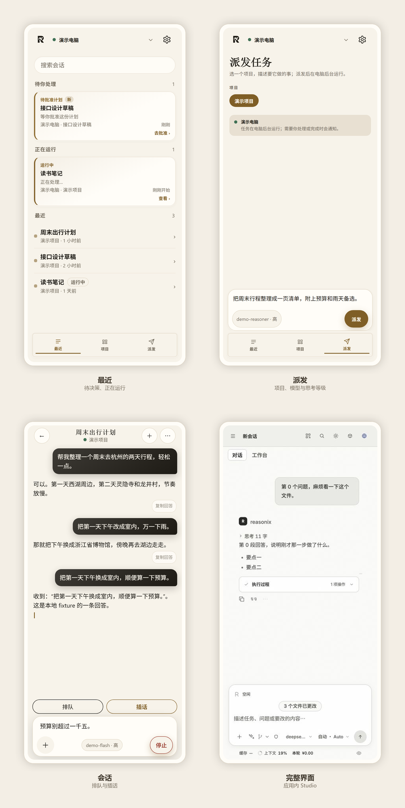

<h1 align="center">Reasonix For Android</h1>

<p align="center">
  <strong>把 Reasonix Studio 装进口袋。</strong><br>
  手机负责界面与连接，模型和任务仍在你的电脑上运行。
</p>

<p align="center">
  <a href="https://github.com/f1shsmell/Reasonix-Android/actions/workflows/ci.yml"></a>
  <a href="https://github.com/f1shsmell/Reasonix-Android/releases"></a>
  <a href="https://github.com/f1shsmell/Reasonix-Android/blob/main/LICENSE"></a>
  
</p>

<p align="center">
  <a href="https://github.com/f1shsmell/Reasonix-Android/releases/latest"><strong>⬇ 下载最新 APK</strong></a>
  &nbsp;·&nbsp;
  <a href="#安装">安装与更新</a>
  &nbsp;·&nbsp;
  <a href="https://github.com/f1shsmell/Reasonix-Android/blob/main/docs/KNOWN_LIMITATIONS.md">已知限制</a>
  &nbsp;·&nbsp;
  <a href="https://github.com/f1shsmell/Reasonix-Android/issues">反馈问题</a>
</p>

<p align="center">
  
</p>

<p align="center"><sub>界面为 Web 构建的无头浏览器渲染，非实机截图。</sub></p>

> [!IMPORTANT]
> 这是第三方、非官方客户端，不包含内核。使用前需要在电脑上安装并运行
> [Reasonix Studio](https://github.com/esengine/DeepSeek-Reasonix)。

## 为什么用它

- **同一 Wi-Fi，直连更快。** 扫描电脑「设备访问」里的二维码完成配对，之后打开 App 就能继续桌面上的会话。
- **离开网络，自动走云端。** 登录同一个 Reasonix 账号，不在家也能连；回到电脑所在 Wi-Fi 再自动切回直连。
- **桌面在跑，手机跟进。** 待处理、正在运行和完成提醒都会到手机；回答、审批、排队、插话，不必回到电脑前。

## 功能

**连接** — 扫码 / 粘贴链接 / 手动地址三种配对；局域网与云端电脑保存为记录，一点切换，回到同一 Wi-Fi 自动优先直连。云端首次连接显示身份指纹，之后每次核对，钥匙变了就拒绝。只有 `/runtimes` 真正应答才算连上；失败退避重试，换网络或回到前台自动重连。

**对话** — 「最近」聚合所有项目，「项目」按文件夹浏览，长按可拖动排序。活动行把思考、命令、读写文件收成一行，点开看参数、输出与 diff，一轮结束再收成摘要。运行中可停止、排队或插话；长思考可单页阅读，回答可复制。支持模型选择、计划模式、图片 / 相机附件、任务清单、审批与结构化问答。

**回退与阅读** — 检查点回退：从「…」菜单选一轮之前的快照，先看恢复计划再确认，只恢复编辑工具写过的文件。会话详略分三档；草稿与阅读位置按会话保留。向上翻读时浮出「↓ 最新」，断线补历史，流中断有提示。

**设置与后台** — 设置分「电脑 / 账号 / 偏好」：连接与账号、主题与后台运行各归其位。直接查看通知权限与电池优化状态，点一行跳到系统设置。

## 通知

被提问、工具批准或计划确认卡住时，手机发一条高优先级通知。默认只有一个「去回答」，点击直达对应会话；打开「在通知里显示选项」后，短选项才会内联。问题解决后通知自动消失，不同会话各有编号和深链，不会互相覆盖。

设置 → 偏好 → 通知里可分别开关：常驻通知（默认关，关闭后不占状态栏但后台照常工作）、需要你处理、弹窗提醒、会话完成。常驻通知会写明当前走局域网还是云端；连续读不到会话时改成「连接中断，正在重试…」，恢复后自动改回。

> [!NOTE]
> 「弹窗提醒」和「常驻通知」由 Android 通知频道控制。频道的重要性在创建时固定，用户手动改过之后 App 也无法再改——所以开关通过切换频道实现，而不是修改已有频道。

**云端后台提醒（默认关闭）** — 设置 → 偏好 → 云端后台提醒。开启后 App 在后台时每 60 秒通过自身的 relay 连接检查云端会话。需要 App 进程和 WebView 还活着：从最近任务划掉后停止，重新打开再恢复。耗电粗略 Wi‑Fi 0.5–1.5%/h、蜂窝 1.5–3%/h。

## 安装

**正式版** — 从 [Releases](https://github.com/f1shsmell/Reasonix-Android/releases/latest) 下载最新签名 APK，可直接覆盖后续正式版。

> 从早期 debug 测试包切换到正式版需要先卸载一次（两者签名不同）。卸载会清空配对信息和连接记录，重装后重新扫码即可。

**CI 测试包** — 每次 push / PR 都会构建 debug APK：[CI 工作流](https://github.com/f1shsmell/Reasonix-Android/actions/workflows/ci.yml) → 选最近一次成功运行 → 在 Artifacts 下载 `reasonix-for-android-debug`。测试包用 debug 签名，适合试用和开发。

**命令行** — `adb install -r app-debug.apk`

**应用内更新** — 设置 → 偏好 → 关于里的「更新」自动检查最新 Release（6 小时限频）。发现新版本后显示版本号和说明，点一下下载并交给系统安装器；第一次需要允许「安装未知应用」。更新沿用固定签名，配对信息、连接记录和本地设置都会保留。优先直连 GitHub，失败自动走镜像。

## 开发

需要 Node 22+、JDK 21 与 Android SDK 36。

```bash
npm ci
npm run typecheck
npm test
npm run build
```

在浏览器里接一个真实内核预览：

```bash
REASONIX_SERVE=http://<desktop>:8791 npm run dev
```

构建 Android 包：

```bash
npm run build
node ./node_modules/@capacitor/cli/bin/capacitor sync android
cd android && ./gradlew assembleDebug
```

产物在 `android/app/build/outputs/apk/debug/app-debug.apk`。

**项目结构** — `src/app/` 应用外壳与连接状态机 · `src/chat/` 对话折叠与输入区 · `src/net/` 内核 / 代理 / 中继客户端 · `android/` Capacitor 壳与原生插件 · `docs/` 交接文档与渲染图。

**发布** — `ci.yml` 在每次 push / PR 跑类型检查、测试与 debug APK（artifact，非发布）；`release.yml` 只在 `vX.Y.Z` tag 时运行，校验 tag、发布说明与版本号后构建签名包。流程见 [RELEASING.md](RELEASING.md)。

更多文档：[交接与决策](docs/HANDOFF.md)、[自建与排障](docs/SELF_HOST.md)、[已知限制](docs/KNOWN_LIMITATIONS.md)、[发版流程](RELEASING.md)。

## 第三方声明

**Reasonix For Android 是第三方、非官方项目**，与 Reasonix、DeepSeek 及其维护者没有隶属关系，也未获其背书。

仓库只包含手机客户端，**不包含内核**；使用前需要在电脑上单独安装并运行 Reasonix Studio。名称与商标归各自所有者，依赖与许可清单见 [NOTICE.md](NOTICE.md)。

界面设计参考了 Qoder 手机端的交互组织方式，代码与实现均为本项目自有。

## License

[MIT](LICENSE) © 2026 f1shsmell and Reasonix For Android contributors.
