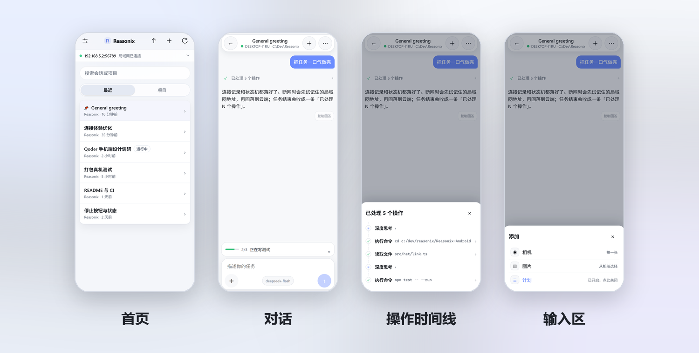
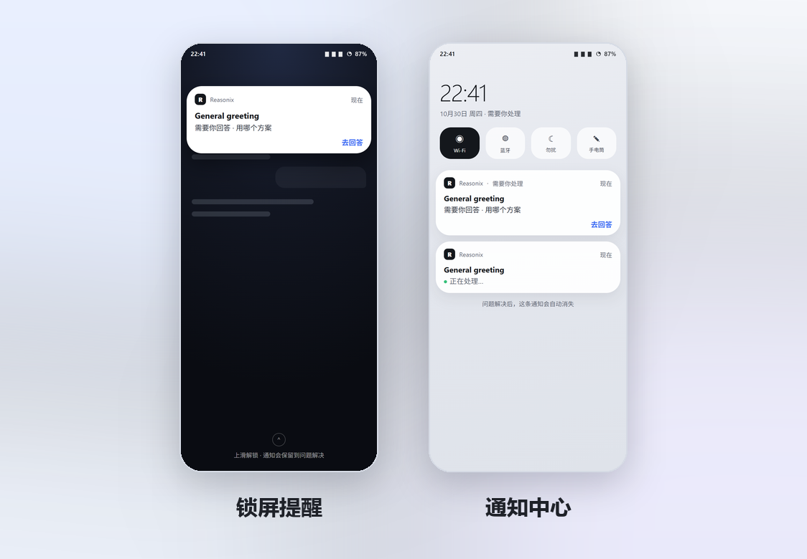

<h1 align="center">Reasonix For Android</h1>

<p align="center">
  <strong>把 Reasonix Studio 装进口袋。</strong><br>
  手机负责界面与连接，模型和任务仍在你的电脑上运行。
</p>

<p align="center">
  <a href="https://github.com/f1shsmell/Reasonix-Android/actions/workflows/ci.yml"></a>
  <a href="https://github.com/f1shsmell/Reasonix-Android/releases"></a>
  <a href="LICENSE"></a>
  
</p>

<p align="center">
  
</p>

<p align="center"><sub>界面为 Web 构建的无头浏览器渲染，非实机截图。</sub></p>

> [!IMPORTANT]
> 这是第三方、非官方客户端，不包含内核。使用前需要在电脑上安装并运行
> [Reasonix Studio](https://github.com/esengine/DeepSeek-Reasonix)。

## 为什么用它

- **同一 Wi-Fi，直连更快。** 扫描电脑「设备访问」里的二维码完成配对，之后打开 App 就能继续桌面上的会话。
- **离开网络，自动走云端。** 登录同一个 Reasonix 账号，不在家也能连；回到电脑所在 Wi-Fi 再自动切回直连。
- **桌面在跑，手机跟进。** 待处理、正在运行和完成提醒都会到手机；回答、审批、排队、插话，不必回到电脑前。

## 功能

### 连接

- 扫码、粘贴链接、手动地址三种配对方式。
- 局域网与云端电脑都会保存为记录，当前连接有标记，点一下即可切换；回到同一 Wi-Fi 自动优先直连。
- 云端电脑第一次连接时显示身份指纹；之后每次连接（包括自动重连）都会核对，钥匙变了就拒绝。
- 只有 `/runtimes` 真正应答才算连接成功；失败退避重试，换网络或回到前台自动重连。

### 对话

- 「最近」聚合所有项目，「项目」按文件夹浏览，长按项目可拖动排序。
- 活动行把思考、命令、读写文件收成一行，点开看参数、输出与 diff；一轮结束后再收成操作摘要。
- 运行中可停止、排队或插话；长思考可单页阅读，回答可复制。
- 支持模型选择、计划模式、图片 / 相机附件、任务清单、审批与结构化问答。
- 检查点回退：从「…」菜单选择一轮之前的快照，先看恢复计划再确认；只恢复编辑工具写过的文件。
- 会话详略分三档：精简、标准、详尽；草稿与阅读位置按会话保留。
- 向上翻读时浮出「↓ 最新」；断线会补历史，流中断有提示。

### 设置与后台

- 设置分「电脑 / 机器 / 偏好」：连接与账号、只读机器状态、主题与后台运行各归其位。
- 「机器」页只读展示最近 30 天用量、上下文占用、工具与权限边界、桌面版本。
- 工具批准是会话属性，放在聊天的「…」菜单里。
- 直接查看通知权限与电池优化状态，点一行跳到对应的系统设置。

## 通知

被提问、工具批准或计划确认卡住时，手机发一条高优先级通知：会话名 + 问题。点「去回答」直达会话，
问题解决后通知自动消失；不同会话使用各自的编号和深链，不会互相覆盖或点开错会话。

运行中的常驻通知会写明当前走局域网还是云端；连续读不到会话时改成「连接中断，正在重试…」，恢复后自动改回。
前台服务持有 CPU 和 Wi-Fi 锁，锁屏后仍能轮询。

<p align="center">
  
</p>

<p align="center"><sub>界面为 Web 构建的无头浏览器渲染，非实机截图。</sub></p>

## 安装

### 正式版

从 [Releases](https://github.com/f1shsmell/Reasonix-Android/releases) 下载最新签名 APK。
正式版使用固定密钥签名，可以直接覆盖后续正式版。

> 从早期 debug 测试包切换到正式版需要先卸载一次（两者签名不同）。卸载会清空配对信息和连接记录，
> 安装后重新扫码即可。

### CI 测试包

每次 push / PR，CI 都会构建一个 debug APK：

1. 打开 [CI 工作流](https://github.com/f1shsmell/Reasonix-Android/actions/workflows/ci.yml)；
2. 选择最近一次成功的运行；
3. 在 **Artifacts** 里下载 `reasonix-for-android-debug`。

测试包使用 debug 签名，适合试用和开发；日常使用请下载 Releases 里的正式版。

### 命令行安装

```bash
adb install -r app-debug.apk
```

## 开发

需要 Node 22+、JDK 21 与 Android SDK 36。

```bash
npm ci
npm run typecheck
npm test
npm run build
```

在浏览器里接一个真实内核预览：

```bash
REASONIX_SERVE=http://<desktop>:8791 npm run dev
```

构建 Android 包：

```bash
npm run build
node ./node_modules/@capacitor/cli/bin/capacitor sync android
cd android && ./gradlew assembleDebug
```

产物在 `android/app/build/outputs/apk/debug/app-debug.apk`。
原生单元测试：`cd android && ./gradlew testDebugUnitTest`。

## CI 与发布

- **`ci.yml`**：每次 push / PR 跑 Web 类型检查、全量测试与构建，以及 Android 原生单元测试和 debug APK。
  APK 是测试产物（artifact，保留 14 天），不是发布。
- **`release.yml`**：只在 `vX.Y.Z` tag 或手动指定已有 tag 时运行。构建前会校验 tag 在 main 上、
  发布说明存在、版本号一致；Release 正文直接使用 `release-notes/android/<version>.md`。
  流程见 [RELEASING.md](RELEASING.md)。

## 项目结构

| 目录 | 内容 |
| --- | --- |
| `src/app/` | 应用外壳、首页、连接设置、连接状态机与已保存连接 |
| `src/chat/` | 对话记录折叠、活动行、操作时间线、输入区与模型面板 |
| `src/net/` | 内核 / 代理 / 中继客户端，HTTP 超时与连接验证 |
| `src/wire/` | 桌面端与手机共享的 wire 类型 |
| `android/` | Capacitor 壳、LoopbackProxy、扫码 / 登录 / 配对 / 保活等原生插件 |
| `docs/` | 交接文档、计划、自建说明与界面渲染图 |

更多文档：[交接与决策](docs/HANDOFF.md)、[自建与排障](docs/SELF_HOST.md)、[发版流程](RELEASING.md)。

## 第三方声明

**Reasonix For Android 是第三方、非官方项目**，与 Reasonix、DeepSeek 及其维护者没有隶属关系，也未获其背书。

仓库只包含手机客户端，**不包含内核**；使用前需要在电脑上单独安装并运行 Reasonix Studio。
名称与商标归各自所有者，依赖与许可清单见 [NOTICE.md](NOTICE.md)。

界面设计参考了 Qoder 手机端的交互组织方式，代码与实现均为本项目自有。

## License

[MIT](LICENSE) © 2026 f1shsmell and Reasonix For Android contributors.
