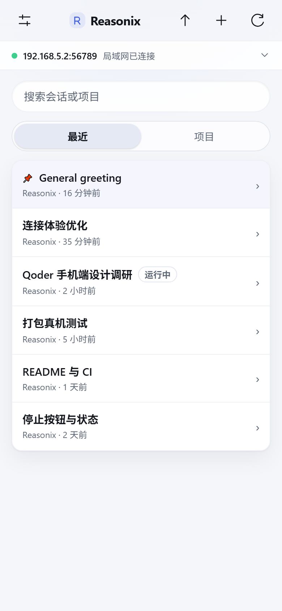
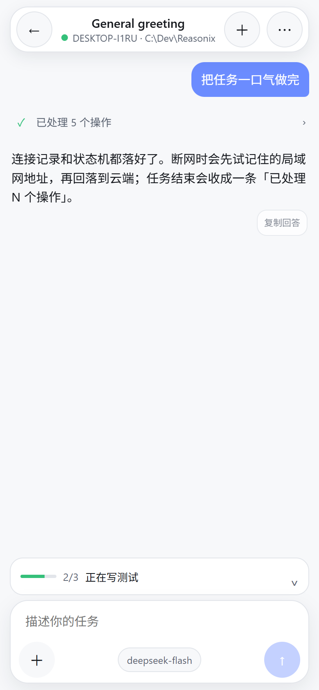
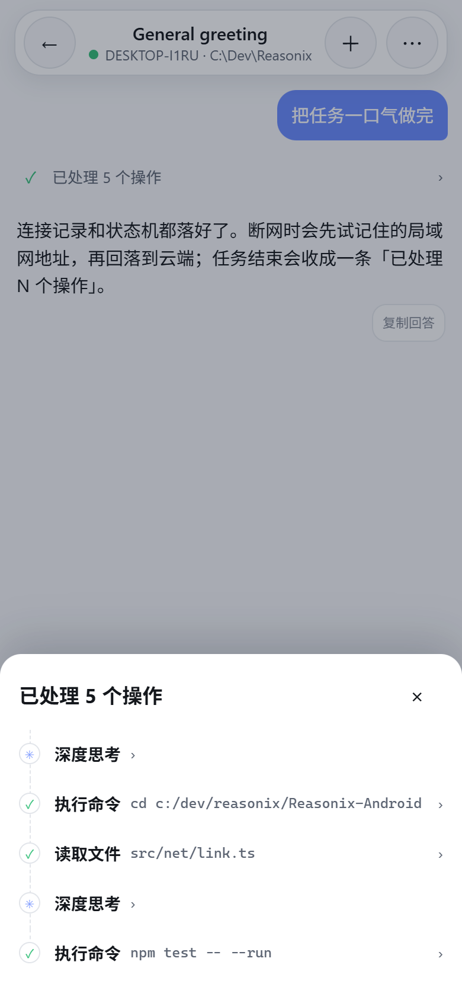
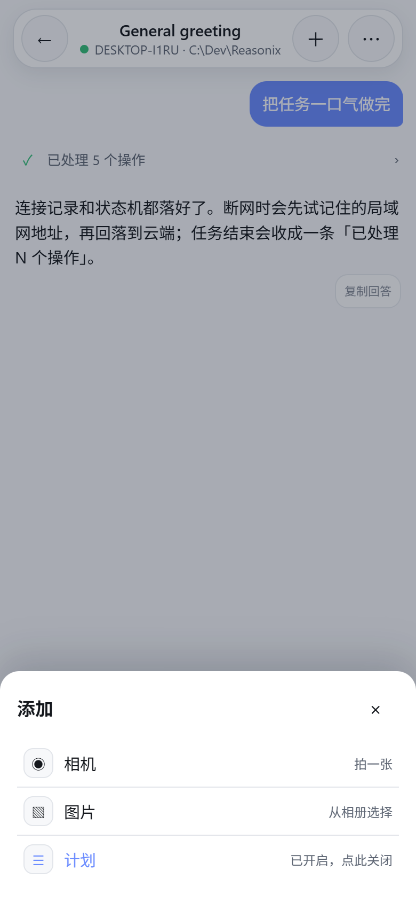
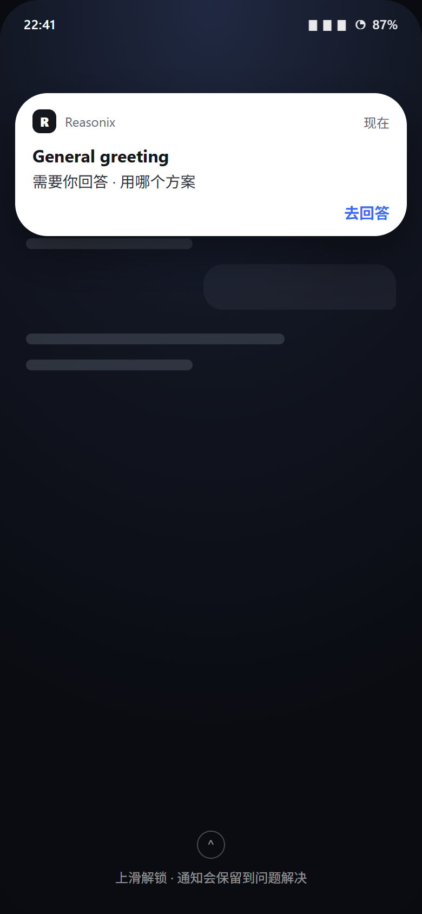
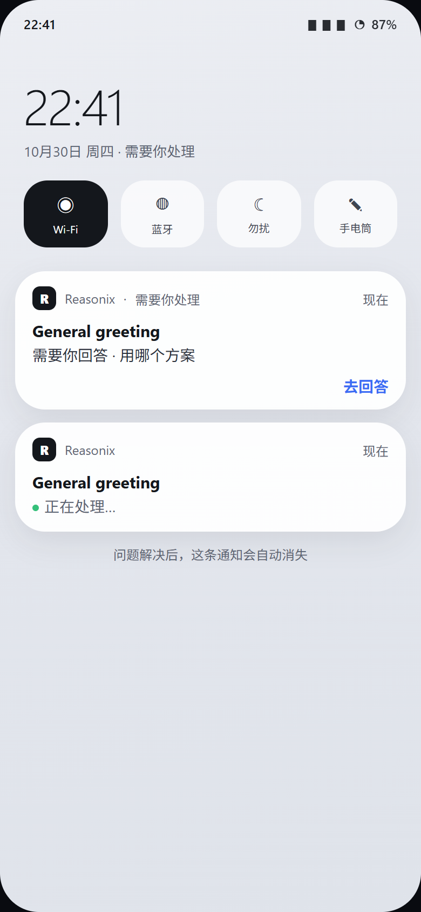

# Reasonix For Android

> 第三方、非官方的 Android 客户端，把 [Reasonix Studio](https://github.com/esengine/DeepSeek-Reasonix) 装进口袋。
> 不内置内核；手机负责界面与连接，任务仍在你的桌面电脑上执行。

[](https://github.com/f1shsmell/Reasonix-Android/actions/workflows/ci.yml)
[](https://github.com/f1shsmell/Reasonix-Android/actions/workflows/release.yml)
[](LICENSE)


<p align="center">
  
  
  
</p>

<p align="center">
  
</p>

<p align="center"><sub>界面图为 Web 构建在无头浏览器中的渲染，不是实机截图。</sub></p>

## 这是什么

Reasonix For Android 是一个 Android 客户端。它不运行模型，也不带内核，只通过手机与桌面端的连接使用
Reasonix Studio 的能力：

- **局域网**：扫描电脑上「设备访问」的二维码，手机与电脑同一 Wi-Fi 时直连。
- **云端**：登录 Reasonix 账号，通过账号中继连接，不在同一网络也能用。
- **自动切换**：回到同一 Wi-Fi 自动切回局域网，离开后回落到云端；已连过的电脑会留下记录，
  在首页连接条或设置里一键切回。

手机端复用了桌面端的 HTTP/SSE 约定，但界面、连接桥和 Android 原生部分都是为手机重写的。

## 功能

**连接**
- 扫码、粘贴链接、手动地址三种配对方式；账号登录使用设备码 + 应用内登录页。
- 已连接的电脑会保存为记录（局域网地址 / 云端设备），当前连接有标记，可一键切换或移除。
- 连接状态机：`探测地址 → 切换上游 → 读取会话`，失败可重试，网络变化/回到前台自动重连，
  退避重试带次数提示；只有 `/runtimes` 真正答上才算连接成功。

**对话**
- 「最近」聚合所有项目的会话；「项目」按文件夹浏览，长按项目可拖动排序。
- 长按会话打开操作表：置顶、打开；置顶会话排在前面并保留 📌。
- **活动行**：思考、执行命令、读取/修改文件都是一行，点开看参数、输出与 diff。
- 任务结束后，同一轮的多步操作收成一条「已处理 N 个操作」，点开是带时间线的操作记录。
- 回答以正文呈现；长思考可以进单页阅读。运行中可**停止**；输入框里可**排队 / 插话**。
- 模型选择、计划模式、图片/相机附件、任务清单进度、审批与结构化问答。问答题始终有
  「其他」自由填写（没有选项也能答），单选还能附一句补充说明。
- **需要你处理的通知**：正在跑的那一轮被提问/审批卡住时，手机会发高优先级通知，
  点开直达该会话；问题解决后通知自动消失。
- 断线补历史、流中断提示、前台服务保活与完成通知。

**设置**
- 主题（跟随系统 / 浅色 / 深色）、工具批准姿势、连接记录、账号与云端电脑、版本信息。

## 通知

正在跑的那一轮被提问、工具批准或计划批准卡住时，手机会发一条高优先级通知：会话名 + 问题；
点「去回答」直接回到那个会话，问题解决后通知自动消失。

<p align="center">
  
  
</p>

<p align="center"><sub>界面示意图（无头浏览器渲染，不是实机截图）。</sub></p>

## 安装

### 从 GitHub Actions 下载

每次推送，CI 都会构建一个可安装的 debug APK：

1. 打开 [CI 工作流](https://github.com/f1shsmell/Reasonix-Android/actions/workflows/ci.yml)；
2. 选择最近一次成功的运行；
3. 在 **Artifacts** 里下载 `reasonix-for-android-debug`。

### 从 Releases 下载

[Releases](https://github.com/f1shsmell/Reasonix-Android/releases) 只包含**明确的版本发布**；
日常提交和修复只跑 CI，不产生 Release。发版需要有版本号、`release-notes/android/<version>.md`
和 main 上的 tag，流程见 [RELEASING.md](RELEASING.md)。

### 命令行安装

```bash
adb install -r app-debug.apk
```

> 这些是 debug 签名的测试包。仓库暂未配置发布签名；需要正式版时请自行提供
> `android/keystore.properties`。

## 开发

环境：Node 22+、JDK 21、Android SDK（API 35/36）。

```bash
npm ci
npm run typecheck
npm test
npm run build
```

浏览器里接一个真实内核预览：

```bash
REASONIX_SERVE=http://<desktop>:8791 npm run dev
```

构建 Android 包：

```bash
npm run build
node ./node_modules/@capacitor/cli/bin/capacitor sync android
cd android && ./gradlew assembleDebug
```

产物：`android/app/build/outputs/apk/debug/app-debug.apk`。
原生单元测试：`cd android && ./gradlew testDebugUnitTest`。

## CI 与产物

- **`.github/workflows/ci.yml`**：每次 push / PR 跑 Web 类型检查、全量测试、构建；
  Android 原生单元测试与 debug APK。APK 是测试产物（artifact，保留 14 天），不是发布。
- **`.github/workflows/release.yml`**：只在 `vX.Y.Z` tag 或手动指定已有 tag 时运行。
  构建前会校验 tag 在 main 上、发布说明存在、版本号一致；Release 正文直接使用
  `release-notes/android/<version>.md`。规则见 [RELEASING.md](RELEASING.md)。

## 目录

```
src/app/       应用外壳、首页、连接设置、连接状态机与已保存连接
src/chat/      对话记录折叠、活动行、操作时间线、输入区与模型面板
src/net/       内核 / 代理 / 中继客户端，HTTP 超时与连接验证
src/wire/      桌面端与手机共享的 wire 类型
android/       Capacitor 壳、LoopbackProxy、扫码/登录/配对/保活等原生插件
docs/          交接文档、计划、界面渲染图
```

## 第三方声明

**Reasonix For Android 是第三方、非官方项目，与 Reasonix、DeepSeek 及其维护者没有隶属关系，
也未获其背书。** 仓库只包含手机客户端，**不包含内核**；使用前需要在电脑上单独安装并运行
Reasonix Studio。名称与商标归各自所有者。依赖与许可清单见 [NOTICE.md](NOTICE.md)。

界面设计参考了 Qoder 手机端的交互组织方式（活动行、操作时间线、悬浮输入区），
代码与实现均为本项目自有。

## License

[MIT](LICENSE) © 2026 f1shsmell and Reasonix For Android contributors.
